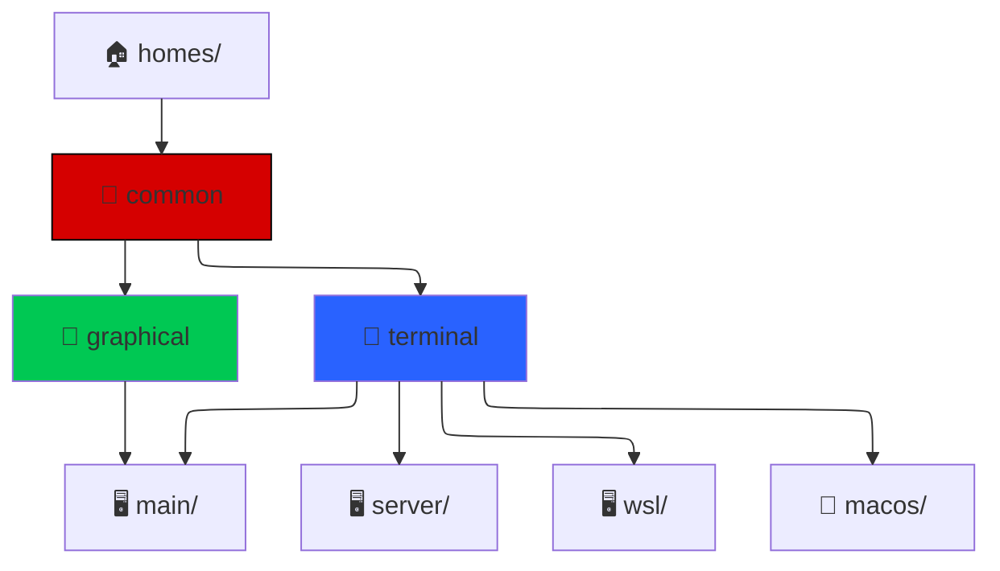

# NixOS

I use NixOS to set up my *nix environments.

I currently have four machines which run nix derivations:

- [[main]] My main personal machine (NixOS)
- [[server]] My homelab server machine (NixOS)
- [[wsl]] My nixOS set up for a WSL machine (NixOS-WSL)
- [[macos]] My work MacBook (nix-darwin)

There is also:
- [[hosts]] - My nixOS derivations for each host (includes common)

You can find most of my nixOS code in this notebook.
I've added comments to places I felt we're adequate

- [[lib]] My nix functions re-used in my derivations
- [[homes]] My home-manager configurations for my various hosts
- [[flakes]] My flake-parts derivations

Here's a mermaid diagram trying to describe my current setup:

## Tools

- [Flakegen](https://github.com/jorsn/flakegen) - Flakegen 
- [Flake-parts](https://github.com/hercules-ci/flake-parts) - Flake parts
- [Home Manager](https://github.com/nix-community/home-manager) - Home Manager
